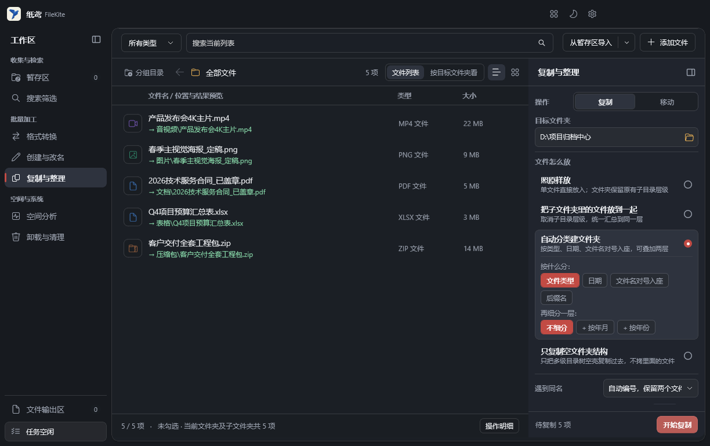
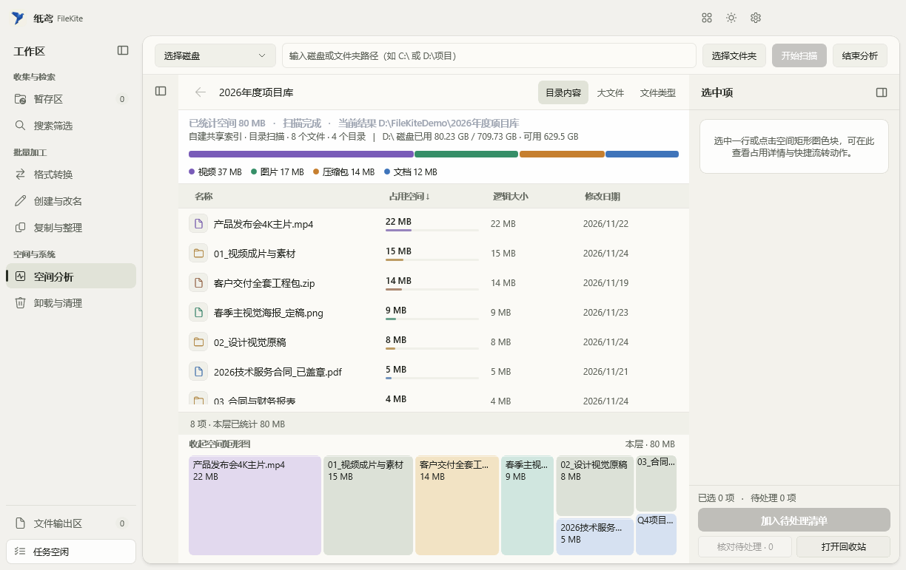
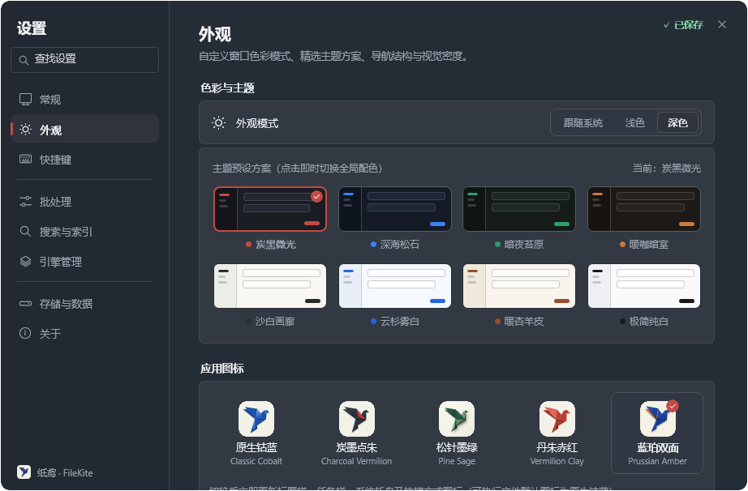
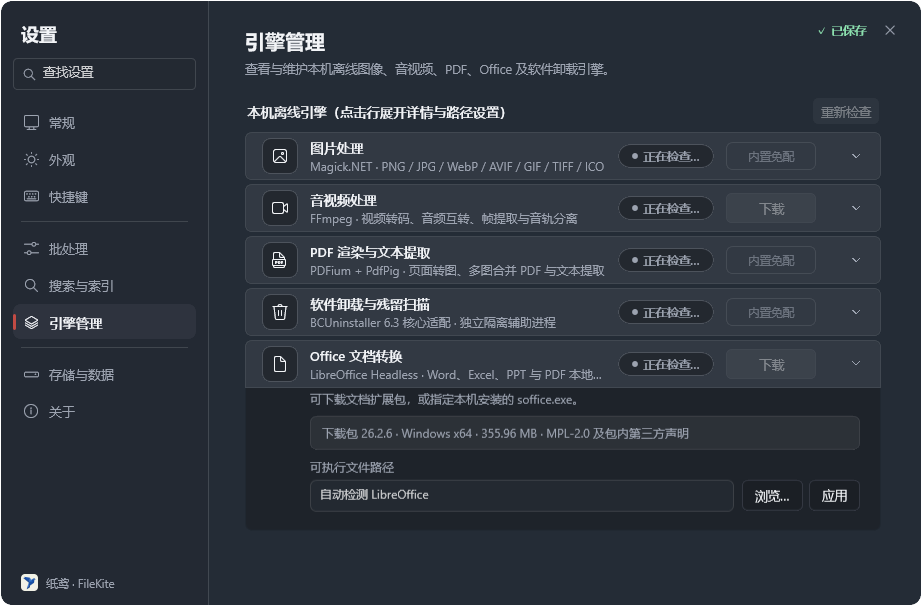

<div align="center">


# 纸鸢 · FileKite

**面向 Windows 10 / 11 的现代原生本地文件操作工作台**  
基于 `C#` · `.NET 10 LTS` · `WinUI 3` 构建 · 纯本机离线运行 · 零云端上传 · 零遥测

[](LICENSE)
[-0078D4.svg)](https://github.com/Markio520/FileKite/releases)
[](global.json)

[**下载免安装版 (Releases)**](https://github.com/Markio520/FileKite/releases) · [**核心功能**](#核心功能) · [**快速构建**](#快速构建与运行) · [**开源许可**](#开源许可与致谢)

</div>

---

## 界面实拍

### 深色「炭黑微光」工作台 · 批量复制与自动分类预览


### 浅色「沙白画廊」工作台 · 磁盘空间分析与交互式矩形树图


### 多套原生云母配色、国风纸鸢图标与本地离线引擎管理
| 8 套深浅色主题与 5 款应用图标 | 纯本机离线转换与卸载引擎管理 |
| :---: | :---: |
|  |  |

---

## 核心功能

- **全盘秒搜与多维筛选**：自研 NTFS MFT + SQLite 共享索引（含 USN 日志增量同步与拼音检索），支持按名称、文件类型、大小区间、修改日期筛选及常用条件保存。
- **磁盘空间分析**：MFT 快速整盘扫描，区分逻辑大小与磁盘实际分配空间，提供目录树、大文件排行、文件类型彩色容量条与交互式矩形树图（Treemap）。
- **文件暂存区与空格快速预览**：跨目录收集文件引用而不改动磁盘原件；按空格键快速预览图片、PDF、文本与音视频首帧，支持多图并排对比。
- **复制与整理**：支持保留目录层级、子目录扁平提取（撞名自动附加来源文件夹名）、按类型/日期/后缀/文件名前缀自动建夹归类（优先解析 EXIF / MP4 真实拍摄时间）、仅复刻空目录结构；跨卷移动强制执行临时文件写入与 `SHA-256` 全量核验，支持一键撤回移动。
- **批量创建与改名**：统一三栏工作区，支持混合多层目录树与有效模板文件批量创建，以及前后缀、替换、序号补零、日期组合与逐项自定义改名，行内实时预览目标路径并支持持久恢复。
- **本地离线格式转换**：内置 `Magick.NET`、`PDFium`、`PdfPig` 与 `FFmpeg`（LGPL shared），支持常见图片、PDF 拆合、音视频转码与提取；按需在「设置 → 引擎管理」中一键下载私有 `LibreOffice` 引擎完成 Office / ODF 文档互转与导出 PDF，断网可用。
- **软件卸载与清理**：集成适配 `BCUninstaller`（Apache-2.0）核心识别与残留扫描能力，支持后台静默卸载、拖拽文件清理、进程占用检测（Restart Manager）与按需提权清理。
- **现代原生工作台体验**：云母（Mica）分层材质、左侧分组导航与单行融合顶栏自由切换、浅色/深色/跟随系统主题、简繁英三语界面与五款内置应用图标。

---

## 下载即用（普通用户）

无需安装 `.NET` 或配置环境：
1. 前往 [**GitHub Releases**](https://github.com/Markio520/FileKite/releases) 下载最新的 `FileKite-v1.0.0-win-x64.zip`；
2. **完整解压**压缩包到任意目录，直接双击 **`FileKite.exe`** 即可启动。

---

## 项目结构

```text
FileKite/
├── src/
│   ├── FileAssistant.App/               # WinUI 3 桌面界面、ViewModel、主题样式与自定义控件
│   ├── FileAssistant.Core/              # 纯业务规则、操作计划、冲突检查与引擎接口（零 UI 依赖）
│   ├── FileAssistant.Infrastructure/    # 文件系统、SQLite 存储、元数据解析与本地转换引擎实现
│   ├── FileAssistant.Indexing/          # 自研文件索引核心与查询引擎
│   ├── FileAssistant.Indexing.Windows/  # Windows NTFS MFT 枚举与 USN 日志增量同步
│   ├── FileAssistant.SpaceScan/         # 独立按需只读提权磁盘扫描辅助进程
│   ├── FileAssistant.BcuCore/           # BCUninstaller 6.3 核心卸载与残留扫描适配层
│   └── FileAssistant.CleanupHost/       # 独立按需提权卸载与清理执行宿主
├── tests/                               # Core / Infrastructure / Indexing / App 四套 xUnit 自动化测试
├── engines/                             # 本地处理引擎固定版本清单（manifest.json）与架构说明
├── scripts/                             # 环境检查、依赖还原、编译、运行、测试与发布打包脚本
└── third-party/                         # 第三方开源许可证原文、NOTICE 与对应源码获取说明
```

> **兼容性说明**：为兼容早期版本的用户配置与本地数据目录，解决方案内部工程名与命名空间沿用 `FileAssistant`。

---

## 快速构建与运行（开发者）

- **系统要求**：Windows 10（1809+）或 Windows 11（推荐 x64）
- **SDK 要求**：`.NET 10 SDK`（受控版本见 [global.json](global.json)）

首次编译时，构建脚本会自动拉取并校验固定 SHA-256 的 `BCUninstaller 6.3` 源码包与 `FFmpeg` LGPL 构建包至本地忽略目录 `artifacts/dependencies/`。

```powershell
# 1. 检查本地 .NET SDK 与构建工具链
.\scripts\check-environment.ps1

# 2. 编译解决方案（Debug 或 Release）
.\scripts\build.ps1 -Configuration Release -Architecture x64

# 3. 以非打包自包含模式直接启动应用
.\scripts\run.ps1 -Configuration Release -Architecture x64 -Unpackaged

# 4. 运行自动化回归测试套件
.\scripts\test.ps1

# 5. 生成瘦身后的免安装便携发布包 (.zip)
.\scripts\package-release.ps1 -Version 1.0.0 -Architecture x64
```

---

## 开源许可与致谢

- 本项目自有源代码采用 **[Apache License 2.0](LICENSE)** 开源许可（Copyright 2026 Markio520）。
- 应用内集成或调用的第三方开源组件（包括 `BCUninstaller`、`Magick.NET`、`PDFium`、`PdfPig`、`FFmpeg`、`LibreOffice`、`SQLite`、`Windows App SDK` 等）均保留其各自的开源许可证与版权声明，详见 [third-party/README.md](third-party/README.md) 与 [third-party/SOURCE-ACCESS.md](third-party/SOURCE-ACCESS.md)。
